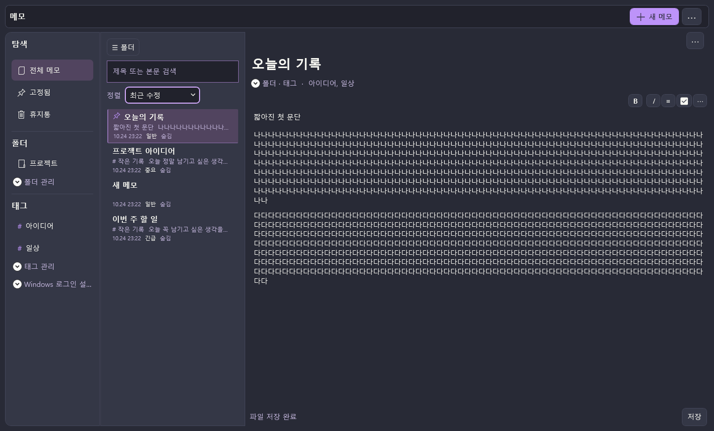
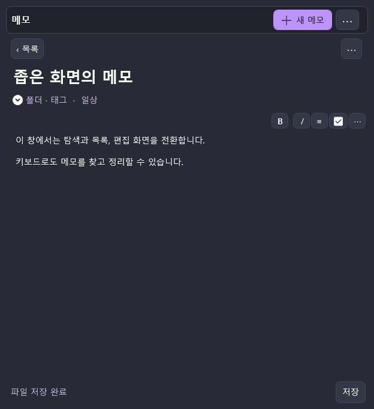
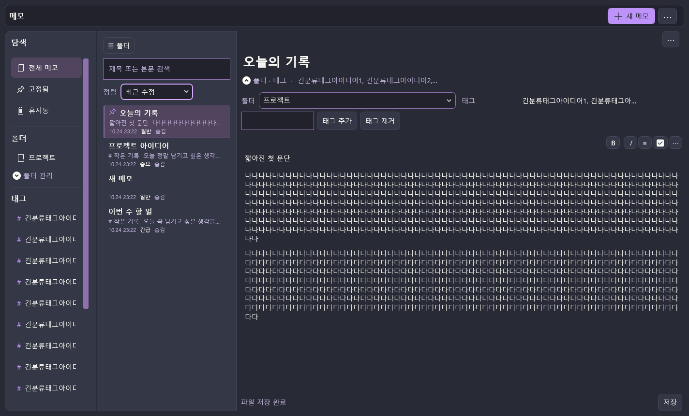
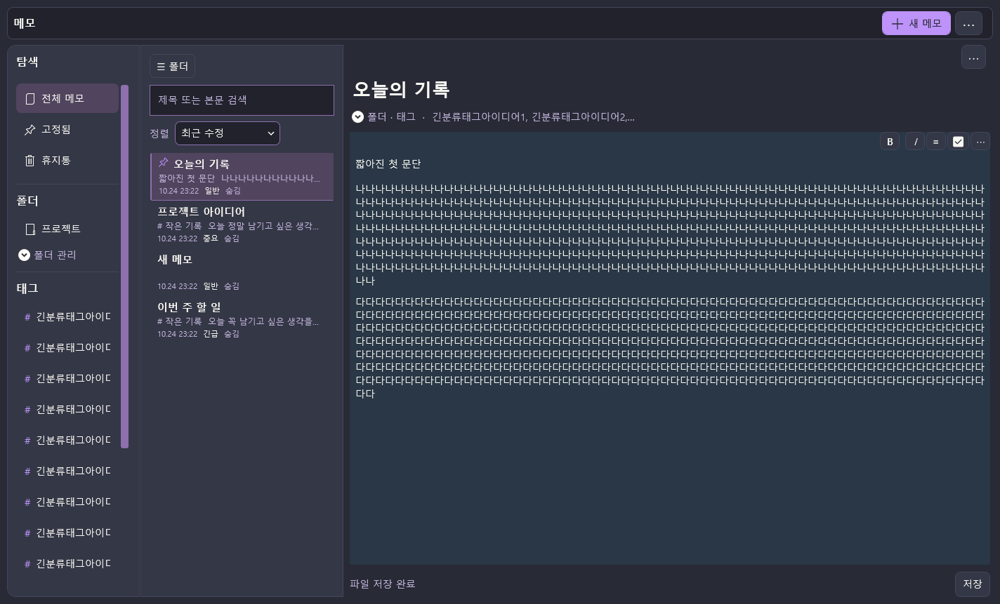

# 사용자 매뉴얼 — Notedex Markdown 메모

**문서 기준일:** 2026-10-24
**대상 버전:** 0.3.0 개발 검증 빌드
**저장 모델:** NoteId별 UTF-8 Markdown 원문 + 분리된 workspace sidecar
**검증 캡처:** 2026-10-24 21:47 KST, 격리 합성 프로필의 실제 interactive WPF 창. 통합 후보 검증 결과는 2026-10-24 23:23 KST 기준.

> 이 문서는 현재 0.3.0 UI 캡처와 코드·검증 결과를 기준으로 다시 작성했습니다. 기능·회귀 검사는 통과했지만 성능 목표와 물리 실기 검증은 남아 있으므로 정식 상용 출시 승인으로 해석하지 마세요. 현재 공식 구매 또는 스토어 링크는 준비되지 않았습니다.

## 1. Notedex 시작하기

관리 창에는 탐색, 메모 목록, 편집 영역이 있습니다. **새 메모**로 기록을 만들고 목록에서 선택해 제목과 본문을 입력합니다. 검색은 제목과 본문을 대상으로 하며, 좁은 창에서는 목록과 편집 화면 사이를 이동합니다.



*그림 1. 0.3.0 통합 검증 후보의 실제 interactive WPF 창을 앱 콘텐츠로 렌더했습니다. 합성 예시 데이터입니다.*



*그림 2. 좁은 창에서 목록→편집→목록 이동과 본문·저장 영역을 확인한 실제 WPF 콘텐츠 렌더입니다.*

## 2. Markdown 편집과 체크리스트

편집 도구에서 굵게, 기울임, 목록, 체크리스트를 작성할 수 있습니다. `Tab`은 현재 줄/체크 항목을 들여쓰고, 더보기에서 내어쓰기와 제목 형식을 선택합니다. **Markdown 원문**은 원래 텍스트를 직접 편집합니다. 모드를 바꾸는 것만으로 본문을 다시 쓰지 않습니다. 지원되지 않거나 안전한 원문 위치 대응이 불가능한 서식은 Markdown 원문 모드에서 확인하세요.

체크리스트 토글은 Markdown task marker를 갱신하며, 작업이 저장되면 `.md` 파일에 기록됩니다. 편집 내용은 입력이 멈춘 뒤 약 600ms 또는 연속 편집 약 4.5초가 지난 시점부터 자동 저장을 시작합니다. 이 값은 저장을 시작하는 조건이며 완료 시간을 보장하지 않습니다. **파일 저장 완료**는 파일 커밋 뒤 표시됩니다.



*그림 3. 긴 태그는 한 줄로 줄여 표시하고 전체 값을 보조 설명으로 확인할 수 있습니다.*

## 3. 메모 분류, 위젯과 외형

폴더와 태그로 메모를 나누고 검색합니다. **고정**은 목록의 접근 우선순위를 높입니다. **중요도**는 일반·중요·긴급 의미 우선순위이며 항상 위 고정과 다릅니다. 휴지통에서 삭제한 메모를 복구할 수 있습니다.

**바탕화면에 표시**는 별도 위젯 창을 엽니다. 관리 창과 위젯은 같은 NoteId 문서 세션을 공유합니다. 숨긴 메모도 관리 창에서 계속 편집할 수 있습니다. 메모별 색상과 글자 크기는 더보기 메뉴에서 설정하며, 선택 즉시 관리 창과 위젯에 반영됩니다.




> 위젯 창과 문서 동기화는 격리 WPF 환경에서 검사했습니다. 실제 Windows Explorer/Win+D/절전 복귀 등 바탕화면 셸 동작은 실기 검증하지 않았습니다.

## 4. Markdown 원본과 보관 위치

기본 저장 위치는 `%LOCALAPPDATA%\Notedex\Notes\markdown-v1\`입니다.

```text
markdown-v1/
├─ notes/<NoteId>.md        본문 원본 (UTF-8 Markdown)
├─ .widget/workspace.json   제목·폴더·태그·고정·우선순위·배치·외형
├─ .trash/                  삭제한 메모 보관
├─ .backups/                내부 백업 데이터
└─ .conflicts/              외부 수정 충돌 보존
```

본문과 메타데이터는 분리되며, workspace JSON에는 본문이 복제되지 않습니다. `.md` 파일의 이름을 직접 바꾸거나 이동하면 연결이 끊길 수 있습니다. 같은 메모를 외부에서 동시에 고치면 앱은 변경본을 성공 저장으로 덮지 않고 충돌 양쪽을 보존합니다.

## 5. 기존 자료 가져오기와 백업

기존 SQLite 데이터베이스나 JSON 백업은 자동 변환하지 않습니다. Markdown 저장소가 없는 기존 데이터가 발견되면 가져오기 흐름이 시작됩니다.

1. `.db`, `.sqlite` 또는 `.json` 파일을 고릅니다.
2. **미리보기**에서 형식과 메모 수를 확인합니다. 이 단계는 원본을 읽기 전용으로 봅니다.
3. 계속할 때는 **확인하고 변환**을 선택하고 별도 확인 대화상자에서 승인합니다. 원본 파일은 유지됩니다.
4. 취소하면 변환하지 않습니다. 성공 후 이전 자료로 돌아가려면 **변환 되돌리고 취소**를 선택합니다. 새 Markdown 자료는 삭제하지 않고 보관 이름으로 이동합니다.

사용자용 전체 백업은 Markdown 본문과 workspace 메타데이터를 함께 보관하고 검증 후 복원합니다. QA 검사에서는 격리 합성 자료의 정상 왕복과 손상 archive 거절·원본 보존을 확인했습니다. 실제 개인 자료를 대상으로 한 전환이나 복원은 수행하지 않았습니다. 실행 전 직접 파일을 복사해 별도 백업하세요.

## 6. Windows 로그인 자동 시작과 설정

관리 창의 왼쪽 **Windows 로그인 설정** 구역에서 **로그인 시 자동 시작**을 켜거나 끕니다. 기본값은 꺼짐이며 현재 사용자 계정의 등록만 관리합니다. Windows 정책이나 시작 앱 설정에서 허용하지 않으면 실행이 막힐 수 있습니다. 격리 테스트에서는 설정이 꺼져 있고 등록을 바꾸지 않도록 보호됩니다. 실제 로그인 뒤 앱 실행은 실기 수용되지 않았습니다.

## 7. 검증 상태와 알려진 제한

| 범위 | 확인 결과 |
|---|---|
| Release/기능 회귀 | 경고 0·오류 0, 통합 회귀 12/12 그룹, Markdown 관련 검사 141개 |
| WPF UI | 통합 후보 WPF UI probe PASS(156개 기록 항목, 진단 문자열 포함), 시작/강제종료 재시작 5개 PASS, 안내 시작 6회 PASS |
| 검색/좁은 창 | 50·100개×10,000자 검색 p95 112.72/115.79ms, compact 본문 높이 399 DIP; 검색 전체 p95 127.22ms |
| 도움말 시작/재시작 | 매뉴얼 이미지 갱신 후 격리 프로필 6회 시작·정상 종료 PASS. 로그인 자동 시작은 별도 실기 검사하지 않음 |
| 성능 목표 | 이전 후보 측정은 재방문 154.0 MiB, 첫 실행 190.7 MiB로 150 MiB 초과. 이번 도움말 이미지 갱신 후보의 메모리는 재측정하지 않아 출시 gate는 미통과 상태 |
| 실기/내구성 | 한국어 IME, Windows DPI·복수 모니터·Explorer/Win+D·절전, 8시간 안정성 미검증 |
| 실제 자료 | 실제 사용자 DB/Markdown으로 변환·복원하지 않음. 격리 합성 프로필만 사용 |
| 구매/배포 | 공식 판매 경로와 상용 출시 수용 미완료 |

이 개발 후보는 GitHub Release용 실행 파일이나 서명된 설치본이 아닙니다. 현재 소스는 PDF 매뉴얼과 앱 내 안내 페이지를 함께 갱신해 포함합니다.

## 8. 도움말과 사용자 매뉴얼

통합 후보는 PDF 안내를 첫 실행에 표시하며, 첫 화면의 `다시 보지 않기` 선택과 관리 창/트레이에서의 수동 재열기를 지원합니다. 격리 테스트에서 안내 시작 6회를 확인했습니다. 이 기능 검사는 메모리 및 물리 Windows 수용을 통과시킨 것은 아닙니다. 최신 Markdown 원고는 [`USER_MANUAL_NOTES.md`](USER_MANUAL_NOTES.md)입니다.

오류를 보고할 때는 버전, 저장 상태, 편집/원문 모드, 위젯 표시 여부와 화면 안내를 기록하세요. 공개 보고서에 개인 메모 본문이나 전체 개인정보를 포함하지 마세요.
